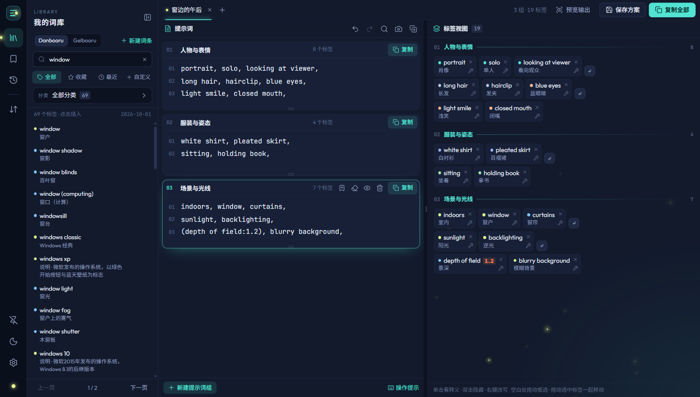
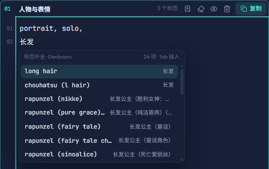

# 词序 · Prompt Studio

词序是一个 Windows 离线提示词编辑器。你可以在左侧查找中英文标签，在中间按人物、服装、场景等分组编写提示词，在右侧对照中文释义，拖动标签调整顺序。

**[下载 Windows x64 便携版 v1.0.0](https://github.com/motionalpha84/Prompt-Studio/releases/download/v1.0.0/Prompt-Studio-1.0.0-Windows-x64.exe)** · [查看正式版发布说明](https://github.com/motionalpha84/Prompt-Studio/releases/tag/v1.0.0)

下载后双击 EXE 即可启动。便携版内置 Danbooru 和 Gelbooru 两套 CSV 词库，以及各自对应的中文释义。首次启动会在本机建立词库，之后可以离线使用。

## 查词与补全

记得英文的一部分，或者只记得中文，都可以直接在编辑器里输入。例如输入 `high`，先显示以 `high` 开头的标签，再显示中间包含 `high` 的标签。输入「长发」也能找到 `long hair`。

用 ↑ / ↓ 选择候选，按 Tab 插入标签并自动补上英文逗号。「设置 → 输入与补全」可以启用回车接受补全、调整逗号后的空格，以及设置候选数量（1–1000，默认 200）。

## 整理与复制

- **分组编写**　每组可以单独命名、隐藏、复制，或保存为片段。「预览输出」可以检查所有可见组的合并结果。
- **拖动标签**　在标签视图的空白处按住鼠标框选，再拖动任一选中的标签，整组标签会按原顺序移到插入线处。支持跨行、跨组移动，原文换行用 ↵ 标记。
- **控制复制格式**　复制当前组、全部内容或选中的标签时，末尾会带上英文逗号。换行、下划线和标签之间的空格可在「设置 → 复制格式」中调整。
- **保存和恢复**　草稿自动保存在本机。可以收藏标签、保存片段和方案，也可以将历史快照恢复为新草稿。

## 快捷键与本机数据

| 快捷键 | 操作 |
| --- | --- |
| Ctrl + Shift + Space | 显示或隐藏工作台，可在「设置 → 桌面行为」重新录制 |
| Ctrl + Enter | 复制当前提示词组 |
| Ctrl + F | 查找当前组内的文字 |
| Ctrl + Z / Ctrl + Y | 撤销 / 重做 |

草稿、词库和设置默认保存在 `%APPDATA%\CixuPromptStudio`。换电脑时，可从「数据」导出完整 JSON 备份并在新电脑恢复。词库 CSV 的导入、导出作用于当前选中的词库。[完整使用说明](./使用说明.txt) · [词库来源与许可](./resources/SOURCES.md)

## 从源码运行

在 Windows 上安装 Node.js 24 和 npm，克隆仓库后执行以下命令。

~~~powershell
npm ci
npm run build
npm start
~~~

- 用 `npm test` 运行核心测试，用 `npm run test:desktop` 运行桌面测试。
- 用 `npm run pack` 构建 Windows x64 便携 EXE，文件生成在项目根目录。随后可用 `npm run test:portable` 验证独立 EXE。
- 桌面测试和便携版测试各自使用独立的数据目录。便携版升级测试默认读取 `test/fixtures/upgrade-sample-0.3.0` 中的测试样本，也可通过 `CIXU_UPGRADE_SAMPLE` 指定样本目录。
- 用 `npm run download:library` 重新获取并验证固定版本的两份英文 CSV。用 `node scripts/handoff.mjs` 生成可直接打开的前端演示及其源文件。
